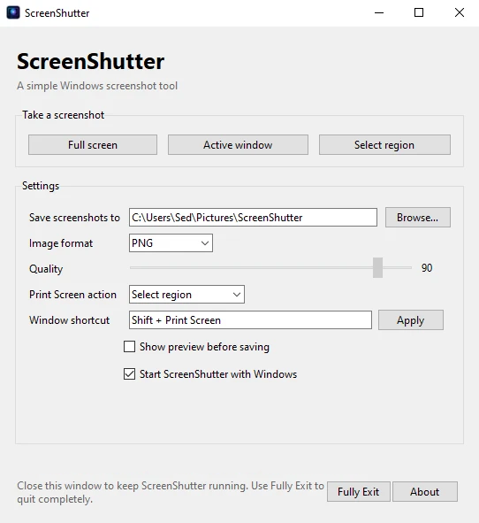

# ScreenShutter

<p align="center">
  <strong>A lightweight screenshot utility for Windows.</strong><br>
  Capture your entire screen, the active window, or a selected region — then save it in the format you want.
</p>

<p align="center">
  <a href="https://github.com/BenFreedomWalker/screenshutter/stargazers"></a>
  <a href="https://github.com/BenFreedomWalker/screenshutter/issues"></a>
  <a href="https://github.com/BenFreedomWalker/screenshutter/blob/main/LICENSE"></a>
  
  
</p>

<p align="center">
  
  &nbsp;&nbsp;
  
  &nbsp;
  
  &nbsp;
  
</p>

---

## Features

- **Three capture modes:** full screen, active window, and drag-to-select region.
- **Multi-monitor support:** captures across the full virtual desktop.
- **Quick capture:** press `Print Screen` to run the selected capture mode.
- **Customizable shortcuts:** configure a shortcut to reopen the main window (default: `Shift+Print Screen`).
- **Multiple image formats:** PNG, JPEG, WEBP, BMP, and TIFF.
- **Image quality control:** adjust JPEG and WEBP quality.
- **Flexible saving:** choose your screenshot folder.
- **Preview or direct save:** review captures before saving, or send them straight to a file.
- **System tray:** keep ScreenShutter running in the background and reopen it when needed.
- **Optional startup:** create a Windows startup shortcut.

## Download

- **[Download the source code](https://github.com/BenFreedomWalker/screenshutter/archive/refs/heads/main.zip)**

Check the [Releases page](https://github.com/BenFreedomWalker/screenshutter/releases) for a ready-to-use Windows executable.

## Installation

### Requirements

- Windows 10 or later
- Python 3.10+
- Tkinter (included with standard Windows Python installers)
- Pillow
- pywin32
- pystray

Install the dependencies:

```bat
py -m pip install -r requirements.txt
```

Run ScreenShutter from source:

```bat
py app.py
```

## Build with Nuitka

Run the build script:

```bat
build.bat
```

This creates a standalone build at:

```text
build\\ScreenShutter.dist\\ScreenShutter.exe
```

To build a single-file executable instead:

```bat
build.bat onefile
```

The one-file executable is written to:

```text
build\\ScreenShutter.exe
```

The build script creates a virtual environment, installs the project dependencies and Nuitka, and then builds the application. Run the build on Windows; cross-compiling from Linux is not supported.

## Keyboard shortcuts

| Shortcut | Action |
| --- | --- |
| `Print Screen` | Capture using the selected capture mode |
| `Shift+Print Screen` | Reopen the ScreenShutter window (default; configurable) |

The window shortcut and the dedicated capture key use the Win32 `RegisterHotKey` API. Windows may reject a shortcut if another application or Windows feature has already claimed it. The window shortcut cannot be set to bare `Print Screen`.

## System tray

- Closing the main window hides ScreenShutter in the system tray.
- Select **Open ScreenShutter** from the tray menu or use the configured window shortcut to reopen it.
- Select **Exit** from the tray menu, or **Fully Exit** in the main window, to terminate the application.

## Screenshots

<p align="center">
  
</p>

<p align="center">
  <em>ScreenShutter's main window — capture modes, output format, quality, shortcuts, and startup settings.</em>
</p>

## Contributing and support

Bug reports, feature requests, and suggestions are welcome.

- [Report a bug](https://github.com/BenFreedomWalker/screenshutter/issues/new)
- [Request a feature](https://github.com/BenFreedomWalker/screenshutter/issues/new)
- [Browse existing issues](https://github.com/BenFreedomWalker/screenshutter/issues)

If you want to contribute code, open an issue first to discuss larger changes, then submit a pull request.

## Support development

If ScreenShutter is useful to you and you'd like to support its development, you can send a tip through Keeper using the GRAM address below:

```text
UQBYSIOzAMkxo1ZWbsFbg7-1vZd2cZbXsEQqYJ
```

Thank you for supporting independent software development.

## License

ScreenShutter is free and open-source software licensed under the [GNU General Public License v3.0](LICENSE).
